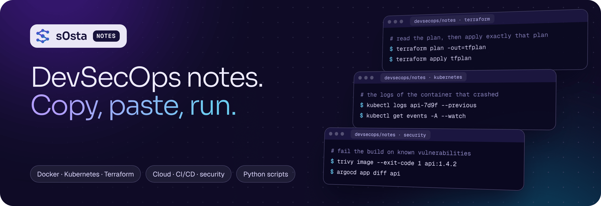

<a href="https://s0sta.com"></a>

# DevSecOps notes

Practical DevSecOps notes from my LinkedIn posts: Docker, Kubernetes, Terraform, CI/CD, cloud, observability and security. Every note has a **quick reference** you can copy, the **full explanation**, and the **script** when there is one.

| Notes | Topics | Scripts |
|:--|:--|:--|
| **223** | **21** | **35** Python scripts, standard library only |

Linux, Windows, networks, storage and databases are in **[IT-Notes](https://github.com/s0sta/IT-Notes)**. The 40 notes that fit both are in both repos.

## How to use it

1. Open a topic below and pick a note.
2. Copy a command from a code box. GitHub shows a copy button on every box.
3. Need a script? It is at the end of the note and in [`scripts/`](scripts).

Looking for one command? Use the search box at the top of GitHub, for example `kubectl logs` or `terraform plan`.

## Notes by topic

<details>
<summary><b>Python scripts</b> · 34 notes</summary>

- [A disk-space alert in 15 lines of Python](notes/p172-a-disk-space-alert-in-15-lines-of-python.md) <sub>P172 · script</sub>
- [Find risky file permissions with Python](notes/p177-find-risky-file-permissions-with-python.md) <sub>P177 · script</sub>
- [A TLS certificate expiry checker in Python](notes/p182-a-tls-certificate-expiry-checker-in-python.md) <sub>P182 · script</sub>
- [A website uptime and latency checker in Python](notes/p187-a-website-uptime-and-latency-checker-in-python.md) <sub>P187 · script</sub>
- [A self-cleaning backup script in Python](notes/p192-a-self-cleaning-backup-script-in-python.md) <sub>P192 · script</sub>
- [A secret scanner in Python for your CI](notes/p197-a-secret-scanner-in-python-for-your-ci.md) <sub>P197 · script</sub>
- [A Kubernetes pod health summary in Python](notes/p202-a-kubernetes-pod-health-summary-in-python.md) <sub>P202 · script</sub>
- [A systemd service watchdog in Python](notes/p207-a-systemd-service-watchdog-in-python.md) <sub>P207 · script</sub>
- [Find SSH brute-force attempts with Python](notes/p212-find-ssh-brute-force-attempts-with-python.md) <sub>P212 · script</sub>
- [Check a site's security headers with Python](notes/p217-check-a-sites-security-headers-with-python.md) <sub>P217 · script</sub>
- [A GitOps drift detector in Python](notes/p224-a-gitops-drift-detector-in-python.md) <sub>P224 · script</sub>
- [An Argo CD sync report in Python](notes/p229-an-argo-cd-sync-report-in-python.md) <sub>P229 · script</sub>
- [nginx latency percentiles in Python](notes/p234-nginx-latency-percentiles-in-python.md) <sub>P234 · script</sub>
- [A Prometheus health check in Python](notes/p239-a-prometheus-health-check-in-python.md) <sub>P239 · script</sub>
- [A Terraform plan gate in Python](notes/p244-a-terraform-plan-gate-in-python.md) <sub>P244 · script</sub>
- [A repository standards checker in Python](notes/p249-a-repository-standards-checker-in-python.md) <sub>P249 · script</sub>
- [An IAM wildcard scanner in Python](notes/p254-an-iam-wildcard-scanner-in-python.md) <sub>P254 · script</sub>
- [A Trivy gate in Python](notes/p259-a-trivy-gate-in-python.md) <sub>P259 · script</sub>
- [An LLM gateway log audit in Python](notes/p264-an-llm-gateway-log-audit-in-python.md) <sub>P264 · script</sub>
- [A GPU workload audit in Python](notes/p269-a-gpu-workload-audit-in-python.md) <sub>P269 · script</sub>
- [A VPC subnet planner in Python](notes/p275-a-vpc-subnet-planner-in-python.md) <sub>P275 · script</sub>
- [An HTTP redirect chain checker in Python](notes/p280-an-http-redirect-chain-checker-in-python.md) <sub>P280 · script</sub>
- [An S3 public access checker in Python](notes/p285-an-s3-public-access-checker-in-python.md) <sub>P285 · script</sub>
- [A Terraform tag auditor in Python](notes/p290-a-terraform-tag-auditor-in-python.md) <sub>P290 · script</sub>
- [A Dockerfile linter in Python](notes/p295-a-dockerfile-linter-in-python.md) <sub>P295 · script</sub>
- [A git repository health report in Python](notes/p300-a-git-repository-health-report-in-python.md) <sub>P300 · script</sub>
- [An SSH configuration auditor in Python](notes/p305-an-ssh-configuration-auditor-in-python.md) <sub>P305 · script</sub>
- [A git history secret scanner in Python](notes/p310-a-git-history-secret-scanner-in-python.md) <sub>P310 · script</sub>
- [A token budget estimator in Python](notes/p315-a-token-budget-estimator-in-python.md) <sub>P315 · script</sub>
- [A GPU utilisation report in Python](notes/p320-a-gpu-utilisation-report-in-python.md) <sub>P320 · script</sub>
- [A consumer lag report in Python](notes/p355-a-consumer-lag-report-in-python.md) <sub>P355 · script</sub>
- [A data freshness checker in Python](notes/p360-a-data-freshness-checker-in-python.md) <sub>P360 · script</sub>
- [A PII column scanner in Python](notes/p365-a-pii-column-scanner-in-python.md) <sub>P365 · script</sub>
- [A data quality checker in Python](notes/p370-a-data-quality-checker-in-python.md) <sub>P370 · script</sub>

</details>

<details>
<summary><b>DevSecOps &amp; cloud security</b> · 24 notes</summary>

- [9 checks for a new cloud account](notes/p159-9-checks-for-a-new-cloud-account.md) <sub>P159</sub>
- [NSG vs Azure Firewall](notes/p188-nsg-vs-azure-firewall.md) <sub>P188</sub>
- [9 checks to secure an Azure subscription](notes/p190-9-checks-to-secure-an-azure-subscription.md) <sub>P190</sub>
- [9 commands for Kubernetes security (CKS)](notes/p213-9-commands-for-kubernetes-security-cks.md) <sub>P213</sub>
- [The secure software supply chain](notes/p215-the-secure-software-supply-chain.md) <sub>P215</sub>
- [5 Kubernetes security mistakes](notes/p216-5-kubernetes-security-mistakes.md) <sub>P216</sub>
- [Trivy vs Falco vs OPA Gatekeeper](notes/p218-trivy-vs-falco-vs-opa-gatekeeper.md) <sub>P218</sub>
- [6 Kubernetes security terms](notes/p219-6-kubernetes-security-terms.md) <sub>P219</sub>
- [The CKS exam by the numbers](notes/p220-the-cks-exam-by-the-numbers.md) <sub>P220</sub>
- [3 Kubernetes security questions](notes/p221-3-kubernetes-security-questions.md) <sub>P221</sub>
- [9 AWS IAM commands for access reviews](notes/p252-9-aws-iam-commands-for-access-reviews.md) <sub>P252</sub>
- [IRSA vs GKE Workload Identity vs Azure Workload Identity](notes/p253-irsa-vs-gke-workload-identity-vs-azure-workload-identity.md) <sub>P253</sub>
- [NetworkPolicy vs service mesh mTLS](notes/p255-networkpolicy-vs-service-mesh-mtls.md) <sub>P255</sub>
- [5 Kubernetes RBAC mistakes](notes/p256-5-kubernetes-rbac-mistakes.md) <sub>P256</sub>
- [How a pod becomes cluster admin](notes/p257-how-a-pod-becomes-cluster-admin.md) <sub>P257</sub>
- [Cloud security terms, decoded](notes/p258-cloud-security-terms-decoded.md) <sub>P258</sub>
- [Anatomy of an IAM policy statement](notes/p260-anatomy-of-an-iam-policy-statement.md) <sub>P260</sub>
- [Quiz: 3 cloud security questions](notes/p261-quiz-3-cloud-security-questions.md) <sub>P261</sub>
- [The shared responsibility model, drawn](notes/p284-the-shared-responsibility-model-drawn.md) <sub>P284</sub>
- [The software supply chain, drawn](notes/p306-the-software-supply-chain-drawn.md) <sub>P306</sub>
- [Four Kubernetes attack paths, drawn](notes/p307-four-kubernetes-attack-paths-drawn.md) <sub>P307</sub>
- [The AWS security cheat sheet](notes/p308-the-aws-security-cheat-sheet.md) <sub>P308</sub>
- [Secrets management: Vault vs cloud KMS vs SOPS](notes/p309-secrets-management-vault-vs-cloud-kms-vs-sops.md) <sub>P309</sub>
- [Quiz: 3 security questions](notes/p311-quiz-3-security-questions.md) <sub>P311</sub>

</details>

<details>
<summary><b>Kubernetes</b> · 20 notes</summary>

- [9 kubectl commands for troubleshooting](notes/p115-9-kubectl-commands-for-troubleshooting.md) <sub>P115</sub>
- [The cloud-native stack, layer by layer](notes/p142-the-cloud-native-stack-layer-by-layer.md) <sub>P142</sub>
- [Fix: Kubernetes ImagePullBackOff](notes/p143-fix-kubernetes-imagepullbackoff.md) <sub>P143</sub>
- [Kubernetes terms, decoded](notes/p156-kubernetes-terms-decoded.md) <sub>P156</sub>
- [What runs inside a Kubernetes node](notes/p157-what-runs-inside-a-kubernetes-node.md) <sub>P157</sub>
- [How a request reaches a pod in Kubernetes](notes/p160-how-a-request-reaches-a-pod-in-kubernetes.md) <sub>P160</sub>
- [5 Kubernetes mistakes in production](notes/p161-5-kubernetes-mistakes-in-production.md) <sub>P161</sub>
- [Quiz: 3 Kubernetes questions](notes/p162-quiz-3-kubernetes-questions.md) <sub>P162</sub>
- [Anatomy of a kubectl command](notes/p203-anatomy-of-a-kubectl-command.md) <sub>P203</sub>
- [9 imperative kubectl commands that save CKA exam time](notes/p204-9-imperative-kubectl-commands-that-save-cka-exam-time.md) <sub>P204</sub>
- [Fix: Kubernetes CrashLoopBackOff](notes/p205-fix-kubernetes-crashloopbackoff.md) <sub>P205</sub>
- [Deployment vs StatefulSet](notes/p206-deployment-vs-statefulset.md) <sub>P206</sub>
- [9 skills to have ready for the CKA exam](notes/p208-9-skills-to-have-ready-for-the-cka-exam.md) <sub>P208</sub>
- [The Kubernetes control plane, part by part](notes/p209-the-kubernetes-control-plane-part-by-part.md) <sub>P209</sub>
- [Kubernetes networking terms, decoded](notes/p210-kubernetes-networking-terms-decoded.md) <sub>P210</sub>
- [What happens when you run kubectl apply](notes/p211-what-happens-when-you-run-kubectl-apply.md) <sub>P211</sub>
- [6 Kubernetes numbers that decide capacity](notes/p248-6-kubernetes-numbers-that-decide-capacity.md) <sub>P248</sub>
- [Inside a Kubernetes cluster](notes/p278-inside-a-kubernetes-cluster.md) <sub>P278</sub>
- [The kubectl command cheat sheet](notes/p292-the-kubectl-command-cheat-sheet.md) <sub>P292</sub>
- [The four Kubernetes objects you actually use, drawn](notes/p298-the-four-kubernetes-objects-you-actually-use-drawn.md) <sub>P298</sub>

</details>

<details>
<summary><b>Cloud: AWS &amp; Azure</b> · 17 notes</summary>

- [9 AWS CLI commands every admin should know](notes/p126-9-aws-cli-commands-every-admin-should-know.md) <sub>P126</sub>
- [AWS vs Azure vs GCP: core services](notes/p139-aws-vs-azure-vs-gcp-core-services.md) <sub>P139</sub>
- [Cloud acronyms, decoded](notes/p171-cloud-acronyms-decoded.md) <sub>P171</sub>
- [9 Azure CLI commands for AZ-104](notes/p183-9-azure-cli-commands-for-az-104.md) <sub>P183</sub>
- [Azure Blob storage tiers: Hot vs Cool vs Archive](notes/p184-azure-blob-storage-tiers-hot-vs-cool-vs-archive.md) <sub>P184</sub>
- [Anatomy of an Azure resource ID](notes/p185-anatomy-of-an-azure-resource-id.md) <sub>P185</sub>
- [6 Azure numbers worth knowing](notes/p186-6-azure-numbers-worth-knowing.md) <sub>P186</sub>
- [How a request reaches a VM in Azure](notes/p189-how-a-request-reaches-a-vm-in-azure.md) <sub>P189</sub>
- [Azure cost at a glance](notes/p191-azure-cost-at-a-glance.md) <sub>P191</sub>
- [The 3-tier architecture on AWS, drawn](notes/p272-the-3-tier-architecture-on-aws-drawn.md) <sub>P272</sub>
- [A serverless web app on AWS, drawn](notes/p282-a-serverless-web-app-on-aws-drawn.md) <sub>P282</sub>
- [The AWS CLI cheat sheet](notes/p283-the-aws-cli-cheat-sheet.md) <sub>P283</sub>
- [Multi-region active-active, drawn](notes/p286-multi-region-active-active-drawn.md) <sub>P286</sub>
- [VPC anatomy, drawn](notes/p287-vpc-anatomy-drawn.md) <sub>P287</sub>
- [The Azure CLI cheat sheet](notes/p288-the-azure-cli-cheat-sheet.md) <sub>P288</sub>
- [5 cloud architecture mistakes](notes/p289-5-cloud-architecture-mistakes.md) <sub>P289</sub>
- [Quiz: 3 cloud architecture questions](notes/p291-quiz-3-cloud-architecture-questions.md) <sub>P291</sub>

</details>

<details>
<summary><b>AI infrastructure &amp; LLM security</b> · 16 notes</summary>

- [The LLM application stack, layer by layer](notes/p262-the-llm-application-stack-layer-by-layer.md) <sub>P262</sub>
- [RAG vs fine-tuning](notes/p263-rag-vs-fine-tuning.md) <sub>P263</sub>
- [5 LLM app security mistakes](notes/p265-5-llm-app-security-mistakes.md) <sub>P265</sub>
- [A prompt's journey through a gateway](notes/p266-a-prompts-journey-through-a-gateway.md) <sub>P266</sub>
- [9 checks before you expose an LLM app](notes/p267-9-checks-before-you-expose-an-llm-app.md) <sub>P267</sub>
- [6 GPU numbers for platform teams](notes/p268-6-gpu-numbers-for-platform-teams.md) <sub>P268</sub>
- [LLM security terms, decoded](notes/p270-llm-security-terms-decoded.md) <sub>P270</sub>
- [Quiz: 3 LLM security questions](notes/p271-quiz-3-llm-security-questions.md) <sub>P271</sub>
- [RAG architecture, drawn](notes/p312-rag-architecture-drawn.md) <sub>P312</sub>
- [Anatomy of an agent, drawn](notes/p313-anatomy-of-an-agent-drawn.md) <sub>P313</sub>
- [The LLM API cheat sheet](notes/p314-the-llm-api-cheat-sheet.md) <sub>P314</sub>
- [A GPU training cluster, drawn](notes/p316-a-gpu-training-cluster-drawn.md) <sub>P316</sub>
- [The GPU and Kubernetes cheat sheet](notes/p317-the-gpu-and-kubernetes-cheat-sheet.md) <sub>P317</sub>
- [Tokens, context and cost, drawn](notes/p318-tokens-context-and-cost-drawn.md) <sub>P318</sub>
- [AI infrastructure terms, decoded](notes/p319-ai-infrastructure-terms-decoded.md) <sub>P319</sub>
- [Quiz: 3 AI infrastructure questions](notes/p321-quiz-3-ai-infrastructure-questions.md) <sub>P321</sub>

</details>

<details>
<summary><b>Data engineering</b> · 16 notes</summary>

- [Kafka architecture, drawn](notes/p352-kafka-architecture-drawn.md) <sub>P352</sub>
- [Kafka delivery semantics, drawn](notes/p353-kafka-delivery-semantics-drawn.md) <sub>P353</sub>
- [The Kafka CLI cheat sheet](notes/p354-the-kafka-cli-cheat-sheet.md) <sub>P354</sub>
- [ETL and ELT, drawn](notes/p356-etl-and-elt-drawn.md) <sub>P356</sub>
- [The lakehouse layers, drawn](notes/p357-the-lakehouse-layers-drawn.md) <sub>P357</sub>
- [The window functions cheat sheet](notes/p358-the-window-functions-cheat-sheet.md) <sub>P358</sub>
- [5 data pipeline mistakes and the fix for each](notes/p359-5-data-pipeline-mistakes-and-the-fix-for-each.md) <sub>P359</sub>
- [Quiz: 3 pipeline questions](notes/p361-quiz-3-pipeline-questions.md) <sub>P361</sub>
- [The feature store, drawn](notes/p362-the-feature-store-drawn.md) <sub>P362</sub>
- [Vector search in four steps](notes/p363-vector-search-in-four-steps.md) <sub>P363</sub>
- [The pgvector cheat sheet](notes/p364-the-pgvector-cheat-sheet.md) <sub>P364</sub>
- [Lakehouse governance, drawn](notes/p366-lakehouse-governance-drawn.md) <sub>P366</sub>
- [Data quality, four checks](notes/p367-data-quality-four-checks.md) <sub>P367</sub>
- [The dbt cheat sheet](notes/p368-the-dbt-cheat-sheet.md) <sub>P368</sub>
- [Data terms, decoded](notes/p369-data-terms-decoded.md) <sub>P369</sub>
- [Quiz: 3 data questions](notes/p371-quiz-3-data-questions.md) <sub>P371</sub>

</details>

<details>
<summary><b>Observability &amp; SRE</b> · 13 notes</summary>

- [Uptime math: what each nine really allows](notes/p116-uptime-math-what-each-nine-really-allows.md) <sub>P116</sub>
- [The four golden signals of monitoring](notes/p150-the-four-golden-signals-of-monitoring.md) <sub>P150</sub>
- [An SLO and error budget at a glance](notes/p165-an-slo-and-error-budget-at-a-glance.md) <sub>P165</sub>
- [6 timeouts every DevOps should set](notes/p166-6-timeouts-every-devops-should-set.md) <sub>P166</sub>
- [9 PromQL queries for real incidents](notes/p232-9-promql-queries-for-real-incidents.md) <sub>P232</sub>
- [The observability stack, layer by layer](notes/p233-the-observability-stack-layer-by-layer.md) <sub>P233</sub>
- [6 numbers that set your monitoring](notes/p235-6-numbers-that-set-your-monitoring.md) <sub>P235</sub>
- [Logs vs metrics vs traces](notes/p236-logs-vs-metrics-vs-traces.md) <sub>P236</sub>
- [How a metric becomes an alert](notes/p237-how-a-metric-becomes-an-alert.md) <sub>P237</sub>
- [5 observability mistakes](notes/p238-5-observability-mistakes.md) <sub>P238</sub>
- [Anatomy of an alert rule](notes/p240-anatomy-of-an-alert-rule.md) <sub>P240</sub>
- [Quiz: 3 observability questions](notes/p241-quiz-3-observability-questions.md) <sub>P241</sub>
- [The observability pipeline, drawn](notes/p297-the-observability-pipeline-drawn.md) <sub>P297</sub>

</details>

<details>
<summary><b>Docker &amp; containers</b> · 12 notes</summary>

- [9 docker commands for when a container fails](notes/p108-9-docker-commands-for-when-a-container-fails.md) <sub>P108</sub>
- [What is inside a Docker image](notes/p109-what-is-inside-a-docker-image.md) <sub>P109</sub>
- [5 Docker mistakes in production](notes/p113-5-docker-mistakes-in-production.md) <sub>P113</sub>
- [Anatomy of a docker run command](notes/p133-anatomy-of-a-docker-run-command.md) <sub>P133</sub>
- [Quiz: 3 container questions](notes/p147-quiz-3-container-questions.md) <sub>P147</sub>
- [Docker Compose vs Kubernetes](notes/p152-docker-compose-vs-kubernetes.md) <sub>P152</sub>
- [Anatomy of a container image reference](notes/p163-anatomy-of-a-container-image-reference.md) <sub>P163</sub>
- [9 docker compose commands for daily work](notes/p164-9-docker-compose-commands-for-daily-work.md) <sub>P164</sub>
- [9 docker commands for building and shipping images](notes/p194-9-docker-commands-for-building-and-shipping-images.md) <sub>P194</sub>
- [Alpine vs Debian base images](notes/p196-alpine-vs-debian-base-images.md) <sub>P196</sub>
- [5 Dockerfile mistakes to avoid](notes/p199-5-dockerfile-mistakes-to-avoid.md) <sub>P199</sub>
- [The Docker command cheat sheet](notes/p277-the-docker-command-cheat-sheet.md) <sub>P277</sub>

</details>

<details>
<summary><b>Git &amp; CI/CD</b> · 12 notes</summary>

- [Quiz: 3 Git questions every developer should know](notes/p132-quiz-3-git-questions-every-developer-should-know.md) <sub>P132</sub>
- [9 git commands to undo mistakes](notes/p134-9-git-commands-to-undo-mistakes.md) <sub>P134</sub>
- [How a git push becomes a running deploy](notes/p145-how-a-git-push-becomes-a-running-deploy.md) <sub>P145</sub>
- [A zero-downtime deployment, minute by minute](notes/p153-a-zero-downtime-deployment-minute-by-minute.md) <sub>P153</sub>
- [Jenkins vs GitHub Actions vs GitLab CI](notes/p154-jenkins-vs-github-actions-vs-gitlab-ci.md) <sub>P154</sub>
- [9 git commands for reading history](notes/p155-9-git-commands-for-reading-history.md) <sub>P155</sub>
- [Fix: a failing GitHub Actions job](notes/p195-fix-a-failing-github-actions-job.md) <sub>P195</sub>
- [How a GitHub Actions workflow is structured](notes/p198-how-a-github-actions-workflow-is-structured.md) <sub>P198</sub>
- [Monorepo vs polyrepo](notes/p243-monorepo-vs-polyrepo.md) <sub>P243</sub>
- [How a commit reaches production, drawn](notes/p293-how-a-commit-reaches-production-drawn.md) <sub>P293</sub>
- [Git merge vs rebase, drawn](notes/p294-git-merge-vs-rebase-drawn.md) <sub>P294</sub>
- [5 CI/CD mistakes and the fix for each](notes/p299-5-ci-cd-mistakes-and-the-fix-for-each.md) <sub>P299</sub>

</details>

<details>
<summary><b>Terraform, Ansible &amp; IaC</b> · 10 notes</summary>

- [Terraform vs Ansible](notes/p137-terraform-vs-ansible.md) <sub>P137</sub>
- [5 Terraform mistakes to avoid](notes/p146-5-terraform-mistakes-to-avoid.md) <sub>P146</sub>
- [9 terraform commands every engineer should know](notes/p149-9-terraform-commands-every-engineer-should-know.md) <sub>P149</sub>
- [Fix: Terraform state lock](notes/p158-fix-terraform-state-lock.md) <sub>P158</sub>
- [Terraform vs CloudFormation vs Pulumi](notes/p169-terraform-vs-cloudformation-vs-pulumi.md) <sub>P169</sub>
- [9 ansible commands to start with](notes/p170-9-ansible-commands-to-start-with.md) <sub>P170</sub>
- [Anatomy of a Terraform resource block](notes/p193-anatomy-of-a-terraform-resource-block.md) <sub>P193</sub>
- [Quiz: 3 Terraform questions](notes/p201-quiz-3-terraform-questions.md) <sub>P201</sub>
- [Terraform vs Crossplane vs Pulumi](notes/p246-terraform-vs-crossplane-vs-pulumi.md) <sub>P246</sub>
- [The Terraform command cheat sheet](notes/p296-the-terraform-command-cheat-sheet.md) <sub>P296</sub>

</details>

<details>
<summary><b>GitOps &amp; Helm</b> · 9 notes</summary>

- [Argo CD vs Flux (GitOps)](notes/p214-argo-cd-vs-flux-gitops.md) <sub>P214</sub>
- [9 Argo CD commands for daily GitOps work](notes/p222-9-argo-cd-commands-for-daily-gitops-work.md) <sub>P222</sub>
- [Anatomy of a helm upgrade](notes/p223-anatomy-of-a-helm-upgrade.md) <sub>P223</sub>
- [Helm vs Kustomize](notes/p225-helm-vs-kustomize.md) <sub>P225</sub>
- [9 checks before you enable auto-sync](notes/p226-9-checks-before-you-enable-auto-sync.md) <sub>P226</sub>
- [How a commit reaches the cluster](notes/p227-how-a-commit-reaches-the-cluster.md) <sub>P227</sub>
- [5 GitOps mistakes and the fix for each](notes/p228-5-gitops-mistakes-and-the-fix-for-each.md) <sub>P228</sub>
- [GitOps terms, decoded](notes/p230-gitops-terms-decoded.md) <sub>P230</sub>
- [Quiz: 3 GitOps questions](notes/p231-quiz-3-gitops-questions.md) <sub>P231</sub>

</details>

<details>
<summary><b>Linux</b> · 9 notes</summary>

- [5 Bash script mistakes that bite in production](notes/p079-5-bash-script-mistakes-that-bite-in-production.md) <sub>P79</sub>
- [The life of a log line](notes/p090-the-life-of-a-log-line.md) <sub>P90</sub>
- [What a healthy Linux server looks like](notes/p135-what-a-healthy-linux-server-looks-like.md) <sub>P135</sub>
- [9 jq commands for working with JSON](notes/p140-9-jq-commands-for-working-with-json.md) <sub>P140</sub>
- [9 SELinux commands that fix Permission denied](notes/p173-9-selinux-commands-that-fix-permission-denied.md) <sub>P173</sub>
- [Fix: the app works with SELinux off, fails with it on](notes/p176-fix-the-app-works-with-selinux-off-fails-with-it-on.md) <sub>P176</sub>
- [The layers that decide who can touch a file on RHEL](notes/p180-the-layers-that-decide-who-can-touch-a-file-on-rhel.md) <sub>P180</sub>
- [Quiz: 3 RHCSA questions](notes/p181-quiz-3-rhcsa-questions.md) <sub>P181</sub>
- [The Linux command cheat sheet](notes/p274-the-linux-command-cheat-sheet.md) <sub>P274</sub>

</details>

<details>
<summary><b>Security &amp; hardening</b> · 9 notes</summary>

- [9 firewall checks with ufw](notes/p081-9-firewall-checks-with-ufw.md) <sub>P81</sub>
- [Defense in depth: 6 layers of security](notes/p098-defense-in-depth-6-layers-of-security.md) <sub>P98</sub>
- [Hashing vs Encryption](notes/p117-hashing-vs-encryption.md) <sub>P117</sub>
- [9 nmap commands to check your own network](notes/p119-9-nmap-commands-to-check-your-own-network.md) <sub>P119</sub>
- [5 password and access mistakes](notes/p124-5-password-and-access-mistakes.md) <sub>P124</sub>
- [9 checks to harden a fresh RHEL server](notes/p178-9-checks-to-harden-a-fresh-rhel-server.md) <sub>P178</sub>
- [firewalld vs iptables](notes/p179-firewalld-vs-iptables.md) <sub>P179</sub>
- [Zero-trust architecture, drawn](notes/p302-zero-trust-architecture-drawn.md) <sub>P302</sub>
- [The security command cheat sheet](notes/p304-the-security-command-cheat-sheet.md) <sub>P304</sub>

</details>

<details>
<summary><b>DevOps basics</b> · 6 notes</summary>

- [Latency numbers every engineer should know](notes/p136-latency-numbers-every-engineer-should-know.md) <sub>P136</sub>
- [DevOps jargon, decoded](notes/p141-devops-jargon-decoded.md) <sub>P141</sub>
- [9 checks before a service is production-ready](notes/p144-9-checks-before-a-service-is-production-ready.md) <sub>P144</sub>
- [Horizontal vs Vertical scaling](notes/p167-horizontal-vs-vertical-scaling.md) <sub>P167</sub>
- [The DORA metrics: 4 numbers that measure delivery](notes/p200-the-dora-metrics-4-numbers-that-measure-delivery.md) <sub>P200</sub>
- [Quiz: 3 toolchain questions](notes/p301-quiz-3-toolchain-questions.md) <sub>P301</sub>

</details>

<details>
<summary><b>Platform engineering</b> · 5 notes</summary>

- [Platform engineering terms, decoded](notes/p242-platform-engineering-terms-decoded.md) <sub>P242</sub>
- [9 checks for a golden-path template](notes/p245-9-checks-for-a-golden-path-template.md) <sub>P245</sub>
- [A developer's first deploy, hour by hour](notes/p247-a-developers-first-deploy-hour-by-hour.md) <sub>P247</sub>
- [Anatomy of a Backstage catalog-info.yaml](notes/p250-anatomy-of-a-backstage-catalog-info-yaml.md) <sub>P250</sub>
- [Quiz: 3 platform engineering questions](notes/p251-quiz-3-platform-engineering-questions.md) <sub>P251</sub>

</details>

<details>
<summary><b>Storage &amp; infrastructure</b> · 3 notes</summary>

- [Block vs File vs Object storage](notes/p129-block-vs-file-vs-object-storage.md) <sub>P129</sub>
- [Anatomy of an /etc/fstab line](notes/p174-anatomy-of-an-etc-fstab-line.md) <sub>P174</sub>
- [9 LVM commands every RHCSA needs](notes/p175-9-lvm-commands-every-rhcsa-needs.md) <sub>P175</sub>

</details>

<details>
<summary><b>Web servers, TLS &amp; HTTP</b> · 3 notes</summary>

- [9 openssl commands for SSL certificate problems](notes/p084-9-openssl-commands-for-ssl-certificate-problems.md) <sub>P84</sub>
- [How a Let's Encrypt certificate is issued and renewed](notes/p123-how-a-lets-encrypt-certificate-is-issued-and-renewed.md) <sub>P123</sub>
- [The TLS handshake, drawn](notes/p303-the-tls-handshake-drawn.md) <sub>P303</sub>

</details>

<details>
<summary><b>IT operations &amp; incidents</b> · 2 notes</summary>

- [9 checks before a server goes live](notes/p089-9-checks-before-a-server-goes-live.md) <sub>P89</sub>
- [The first 30 minutes of an outage](notes/p138-the-first-30-minutes-of-an-outage.md) <sub>P138</sub>

</details>

<details>
<summary><b>Databases &amp; SQL</b> · 1 notes</summary>

- [A zero-downtime database migration](notes/p168-a-zero-downtime-database-migration.md) <sub>P168</sub>

</details>

<details>
<summary><b>Networking &amp; DNS</b> · 1 notes</summary>

- [Subnet sizes cheat sheet](notes/p127-subnet-sizes-cheat-sheet.md) <sub>P127</sub>

</details>

<details>
<summary><b>Windows &amp; Active Directory</b> · 1 notes</summary>

- [Active Directory vs Entra ID](notes/p128-active-directory-vs-entra-id.md) <sub>P128</sub>

</details>


## What is in a note

Each file in [`notes/`](notes) is Markdown with a short header:

```yaml
---
id: p72
title: "9 curl commands for debugging websites"
sections: [it]              # it, devsecops, or [it, devsecops]
topic: "Web servers, TLS & HTTP"
tags: [Linux, curl, SysAdmin]
source: "LinkedIn post P72 · Linux series"
---
```

Then the parts: **Quick reference** (commands, checklists, tables), **Explained** (the full post), **In one line** (the short version) and, for script posts, **Script**.

## Folders

```text
notes/     223 notes, one Markdown file each (p072-....md)
scripts/   35 Python scripts from the posts
tools/     the converter that turns my LinkedIn post folders into notes for both repos
```

---

Made by **Hosam Hani** ([s0sta](https://github.com/s0sta)) · [s0sta.com](https://s0sta.com) · [LinkedIn](https://www.linkedin.com/in/hosam-hani-abdelati) · Contact: [s0sta.com/#contact](https://s0sta.com/#contact)
